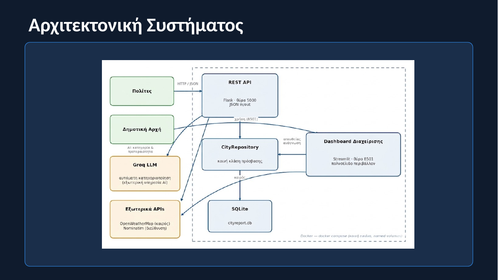
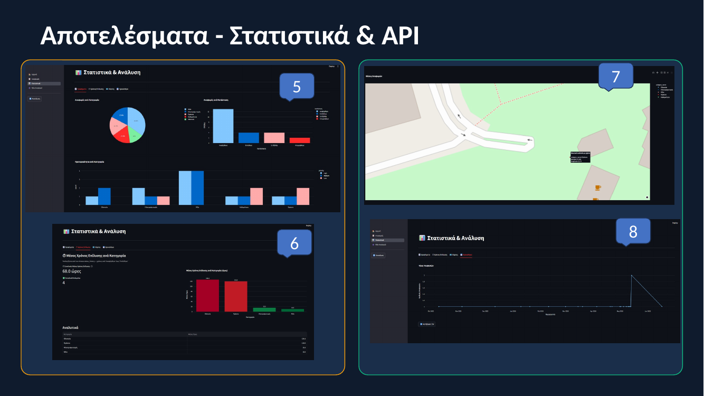
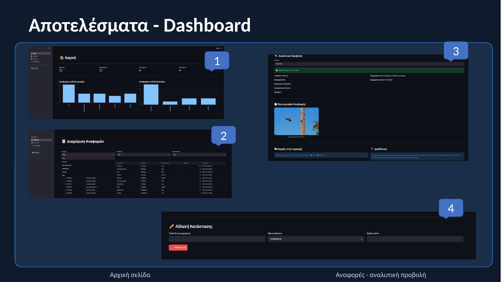

# CityReport - Smart City Issue Tracker

An anonymous municipal issue-reporting system: citizens report urban problems (potholes, broken street lights, garbage, etc.) via a REST API, and staff triage and resolve them through an admin dashboard. Submitted issues are automatically geocoded, categorized, and prioritized using an LLM.

**Stack:** Flask (REST API) · Streamlit (Admin Dashboard) · SQLite · Groq API (Llama 3.3 70B) · OpenWeatherMap · Nominatim (OpenStreetMap) · pandas / plotly · Docker

---

## Why this matters

Municipal issue-reporting systems typically rely on manual triage: staff read every incoming report, decide what category it belongs to, and judge how urgent it is. That's slow and inconsistent, especially under a high report volume. CityReport automates the first pass - every submission is auto-categorized and auto-prioritized by an LLM the moment it arrives, with rule-based fallbacks if the AI call fails, so staff start from a pre-sorted queue instead of a blank inbox.



---

## What this project covers

**Citizen-facing REST API** (no authentication - reports are anonymous by design):
- Submit a report with just a title, description, and coordinates
- Duplicate detection: a new report matching an existing title within ~100m of an existing one is merged into an upvote instead of creating a new ticket
- Automatic reverse geocoding (coordinates → human-readable address) via Nominatim
- Automatic category (1 of 5) and priority (Low/Medium/High) assignment via the Groq LLM, with a safe fallback (`category: Other`, `priority: Medium`) if the API key is missing or the call fails
- Ticket tracking, description updates, upvoting, photo upload

**Admin Dashboard** (Streamlit, multipage):
- **Home** - KPIs and category/status distribution
- **Reports** - filter by category/status/priority, drill into a single ticket (photo, live weather at the report's location, address), change status with an admin comment
- **Statistics** - category/status/priority breakdowns, resolution-time analytics, a map, and a time-series trend (see below)

**Data layer:**
- SQLite with a normalized schema: `category`, `status`, `problem`, `status_history`
- Every status transition is logged to `status_history`, which is what powers the resolution-time analytics - not just the current state

📊 **[View the full project presentation](report/CityReport_Presentation.pdf)** - full business context, architecture, and results walkthrough.

---

## Analytics & reporting (indicative)

The Statistics page is where the data-analysis work lives: category and status distributions, priority breakdowns, average resolution time per category (computed from a full status-change history, not just current state), a geospatial view of all reports, and a submissions-over-time trend with CSV export for further analysis.



- **Resolution time per category** - derived from `status_history`, so it reflects actual time-in-status rather than a single timestamp
- **Category/status/priority breakdowns** - pie and bar charts built with plotly
- **Geospatial view** - every report plotted by coordinates, colored by category
- **Time series** - submission trend over time, with the underlying data exportable as CSV

---

## Admin Dashboard



---

## Repository structure

```
cityreport-issue-tracker/
├── app/
│   ├── model/
│   │   └── problem.py            # Problem entity (constructor, to_dict/from_dict)
│   └── repository.py             # All DB access (Repository pattern)
├── pages/
│   ├── 1_Home.py                 # Dashboard: KPIs & summary charts
│   ├── 2_Reports.py              # Dashboard: filtering, ticket detail, status updates
│   └── 3_Statistics.py           # Dashboard: analytics, resolution times, map, CSV export
├── src/
│   ├── api/
│   │   └── routes.py             # Flask REST endpoints + Groq AI categorization
│   └── database/
│       └── db.py                 # Schema creation + reference data seeding
├── postman/
│   └── CityReport_API_postman_collection.json
├── report/
│   └── CityReport_Presentation.pdf   # Project presentation (business + technical walkthrough)
├── assets/                       # Screenshots used in this README
├── .streamlit/
│   └── config.toml
├── dashboard.py                  # Streamlit entry point
├── run.py                        # Flask entry point
├── seed_data.py                  # Seeds 22 realistic sample reports directly into the DB
├── seed_via_api.py               # Submits 22 more reports through the REST API (demonstrates the AI pipeline end-to-end)
├── docker_init.py                # DB init + conditional seeding for the container
├── docker-compose.yml
├── Dockerfile
├── requirements.txt
├── .env.example
└── LICENSE
```

---

## Data & attribution

All data in this project (the 44 sample issue reports, placeholder photos) is **synthetic**, generated by the seeding scripts for demonstration purposes. There is no external dataset and no attribution requirement - coordinates, addresses, and report content are all fabricated for the Athens/Piraeus area.

---

## Prerequisites

- Python 3.10+
- Docker & Docker Compose (recommended way to run it)
- Free API keys:
  - [Groq](https://console.groq.com) - for automatic categorization
  - [OpenWeatherMap](https://openweathermap.org/api) - for the weather widget in the dashboard

---

## Running it

### With Docker (recommended)

```bash
# 1. Copy the example env file and fill in your keys
cp .env.example .env

# 2. Start everything
docker-compose up --build
```

| Service | URL |
|---|---|
| REST API (Flask) | http://localhost:5000 |
| Admin Dashboard (Streamlit) | http://localhost:8501 |

On first run, `docker_init.py` initializes the database and loads 22 sample reports automatically. Stop with `docker-compose down`.

To demonstrate the AI pipeline end-to-end (22 more reports submitted through the live API, each auto-categorized on arrival):

```bash
docker exec cityreport_api python seed_via_api.py
```

### Locally with venv

```bash
python -m venv venv
venv\Scripts\activate        # Windows
# source venv/bin/activate   # Mac/Linux

pip install -r requirements.txt
cp .env.example .env         # fill in your keys

python src/database/db.py    # create schema
python seed_data.py          # load 22 sample reports

python run.py                # terminal 1 - Flask API
streamlit run dashboard.py   # terminal 2 - dashboard
```

---

## REST API - Endpoints

Base URL: `http://127.0.0.1:5000`. No authentication - the API is designed for anonymous citizen submissions.

| # | Method | Endpoint | Description |
|---|---|---|---|
| 1 | `POST` | `/api/problems` | Submit a new report - returns a `ticket_id` |
| 2 | `GET` | `/api/problems` | Search & filter reports |
| 3 | `GET` | `/api/problems/<ticket_id>` | Track a specific report |
| 4 | `PUT` | `/api/problems/<ticket_id>` | Update a report's description |
| 5 | `POST` | `/api/problems/<ticket_id>/photo` | Upload a photo |
| 6 | `POST` | `/api/problems/<ticket_id>/upvote` | Upvote a report |

A ready-to-import Postman collection is in `postman/`.

---

## Database schema

| Table | Purpose |
|---|---|
| `category` | Οδοποιία (Road issues), Ηλεκτροφωτισμός (Street lighting), Καθαριότητα (Cleanliness), Πράσινο (Green spaces), Άλλο (Other) |
| `status` | Αναφέρθηκε (Reported), Σε Εξέλιξη (In Progress), Επιλύθηκε (Resolved), Απορρίφθηκε (Rejected) |
| `problem` | The reports themselves |
| `status_history` | Every status transition, timestamped - powers the resolution-time analytics |

---

## AI subsystem

On every `POST /api/problems`, the API calls the Groq API (`llama-3.3-70b-versatile`) with a system prompt constrained to return `{"category_id": 1-5, "priority": "Low"|"Medium"|"High"}` as strict JSON. If `GROQ_API_KEY` is missing or the call fails for any reason, the system falls back to `category: Other, priority: Medium` rather than failing the request. The categorization logic itself is prompt-based only - there's no accuracy evaluation against labeled data, which would be a natural next step if this were extended beyond coursework.

---

## Known limitations

- No authentication on either the citizen API or the admin dashboard - reports are anonymous by design, but a production version would need at least admin-side auth.
- Flask debug mode is off by default (enable it with `FLASK_DEBUG=1`), but the built-in development server is still not production-safe.
- AI categorization accuracy hasn't been formally evaluated against a labeled test set.

---

## Future work

- Automated tests (pytest) for the repository and the REST API, using a temporary database.
- A GitHub Actions workflow that runs the tests on every push.

---

## Author

MSc coursework project - Information Systems & Services, University of Piraeus, 2026.
Angeliki Lagogianni, Petros Tzavellas.

## License

MIT - see [LICENSE](LICENSE).
